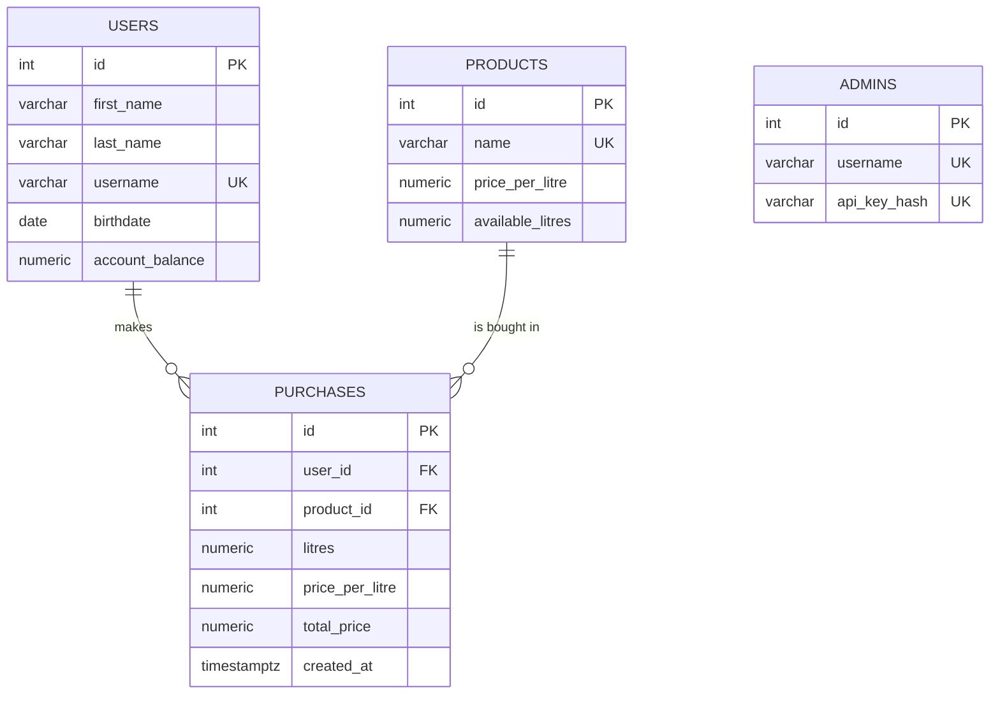

# Fuel Purchase API

A REST API for a fuel purchasing system. Users buy fuel with their account balance and view their purchase history. Administrators manage products, stock, and users.

**Stack:** Python 3.12, FastAPI, SQLAlchemy 2.0, PostgreSQL 16, Docker Compose.

## Quick Start

Requirements: Docker with Docker Compose.

```bash
cp .env.example .env
docker compose up --build
```

In a second terminal, create the administrator:

```bash
docker compose exec api python -m scripts.create_admin admin
```

This prints the admin API key once. Save it: you need it for the admin API calls, and only its hash is stored in the database.

| | URL |
|---|---|
| API | http://localhost:8000 |
| Interactive docs (Swagger UI) | http://localhost:8000/docs |
| Health check | http://localhost:8000/health |

The credentials in `.env.example` are development defaults:)

Commands used for building/shutting down project, and for testing:

| Command | Purpose |
|---|---|
| `docker compose up --build` | Rebuild and start after changing code |
| `docker compose down` | Stop everything (data is kept) |
| `docker compose down -v` | Stop and delete the database data (clean start) |
| `docker compose exec api python -m pytest` | Run the tests |

## Authentication

| Who | Header | Used for |
|---|---|---|
| Administrator | `X-Admin-Key: <key>` | `/api/admin/*` |
| User | `X-Username: <username>` | `/api/purchases/` |

## Endpoints

| Method | Path | Auth | Description |
|---|---|---|---|
| POST | `/api/admin/products/` | admin | Create a product |
| PATCH | `/api/admin/products/{product_id}/` | admin | Update name, price, or stock |
| POST | `/api/admin/users/` | admin | Create a user |
| PATCH | `/api/admin/users/{user_id}/` | admin | Update user info or set the balance |
| POST | `/api/purchases/` | user | Buy fuel |
| GET | `/api/purchases/` | user | List own purchases, newest first |

### Example session

The easiest way to try the API is Swagger UI at `/docs`. 

Or with curl:

```bash
KEY=<the key printed by create_admin>

curl -X POST localhost:8000/api/admin/products/ \
  -H "X-Admin-Key: $KEY" -H "Content-Type: application/json" \
  -d '{"name": "Petrol 95", "price_per_litre": "500.00", "available_litres": "1000"}'

curl -X POST localhost:8000/api/admin/users/ \
  -H "X-Admin-Key: $KEY" -H "Content-Type: application/json" \
  -d '{"first_name": "John", "last_name": "Smith", "username": "john", "birthdate": "1995-05-20", "account_balance": "10000.00"}'

curl -X POST localhost:8000/api/purchases/ \
  -H "X-Username: john" -H "Content-Type: application/json" \
  -d '{"product_id": 1, "litres": 10}'

curl localhost:8000/api/purchases/ -H "X-Username: john"
```

A successful purchase returns `201`:

```json
{
  "id": 1,
  "product": "Petrol 95",
  "litres": "10.00",
  "total_price": "5000.00",
  "remaining_balance": "5000.00",
  "remaining_stock_litres": "990.00"
}
```

## Errors

Every error has the same shape: `{"error": "message"}`.

| Status | When |
|---|---|
| 400 | Insufficient balance, or not enough fuel in stock |
| 401 | Missing `X-Admin-Key` or `X-Username` header |
| 403 | Invalid admin key |
| 404 | Unknown user, product, or route |
| 409 | Duplicate username or product name |
| 422 | Invalid input: litres not a number, zero or negative; negative price, stock, or balance; invalid birthdate; unknown fields |

A failed purchase never changes the balance or stock, and never creates a purchase record.

## Database structure



- **users / products:** one user can make many purchases, and one product can appear in many purchases. `purchases` links the two.
- **admins:** stands alone. Administrators only authenticate; they do not own other data.
- **Money and litres** are `NUMERIC(12, 2)`: exact decimals.
- **Database constraints** back up the API validation: price, stock, and balance cannot be negative, and purchased litres must be positive.
- **`purchases.price_per_litre`** is the price used at the time of purchase, so later price changes never alter history.

## Project structure

```
app/
  main.py            app setup, routers, startup (creates tables)
  config.py          settings from environment variables
  database.py        engine, session, Base
  models.py          database tables (SQLAlchemy)
  schemas.py         request and response validation (Pydantic)
  security.py        admin key generation and hashing
  dependencies.py    admin and user authentication
  errors.py          uniform {"error": ...} responses
  routers/
    admin.py         the four admin endpoints
    purchases.py     purchase and history endpoints
  services/
    purchases.py     the purchase transaction
scripts/
  create_admin.py    creates an administrator and prints its key once
tests/
  conftest.py        test database and fixtures
  test_admin.py      admin endpoint tests
Dockerfile
docker-compose.yml
.env.example
requirements.txt
```

## Design decisions

- **Atomic purchases.** The whole purchase runs in one database transaction. The product and user rows are locked (`SELECT ... FOR UPDATE`, always in the same order), so simultaneous purchases cannot oversell stock or overspend a balance.
- **Admin key.** A random 256-bit key. Only its SHA-256 hash is stored, it is compared in constant time, and the raw key is never committed. Administrators are created with the setup script, as the task allows.
- **Purchase input is minimal.** A purchase accepts only `product_id` and `litres`. Unknown fields are rejected, so users cannot change prices, stock, or balances.
- **Rounding.** `total_price` is rounded to 2 decimals (half up). `litres` accepts at most 2 decimals.
- **Product names are unique.** Renaming a product changes how past purchases are displayed, because history shows the current product name.
- **Usernames are case-sensitive.**
- **Balance updates.** `PATCH` on `account_balance` sets the balance to the given value; it does not add to it.
- **Tables are created on startup.** There are no migrations; use `docker compose down -v` after changing the models.

## Tests

```bash
docker compose exec api python -m pytest
```

The tests cover the admin endpoints and run against an in-memory SQLite database, so they never touch the PostgreSQL data.

Note: the tests currently cover the admin endpoints. Next steps would be adding tests for the purchase endpoint and using `pytest.mark.parametrize` to cover many invalid inputs with a single test.